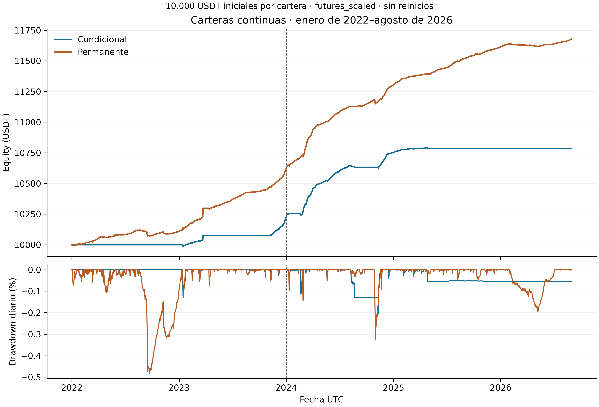

# Carteras continuas

Las dos cuentas conservan capital y posiciones entre años. Las tablas originales
y sus gráficos corresponden al intervalo enero de 2022–agosto de 2026 UTC.

| Para consultar | Fuente |
|---|---|
| Patrimonio, retorno y atribución del P&L | [Resultados por período](tablas/resultados_periodos.csv) y [serie diaria](tablas/equity_diario.csv). |
| Órdenes, aperturas y ciclos | [Actividad](tablas/actividad.csv). |
| Exposición | [Tiempo invertido](tablas/tiempo_invertido.csv). |
| Selección de entradas | [Filtros](tablas/filtros_entrada.csv). |
| Predicción | [H1 por activo y período](tablas/h1_resumen.csv). |
| Oportunidad | [H3 por período](tablas/h3_resumen.csv) y [serie diaria conjunta](tablas/h3_diario_conjunto.csv). |

Los identificadores `conditional` y `permanent` designan respectivamente las
carteras condicional e incondicional. El [diccionario](../../../docs/data_dictionary.md)
explica las unidades. La evidencia detallada permanece en el
[ZIP continuo](../../../data/evidence/carteras_continuas.zip).

[Resultados de H1/H2/H3](../README.md) · [Reproducción](../../../docs/reproduction.md).
