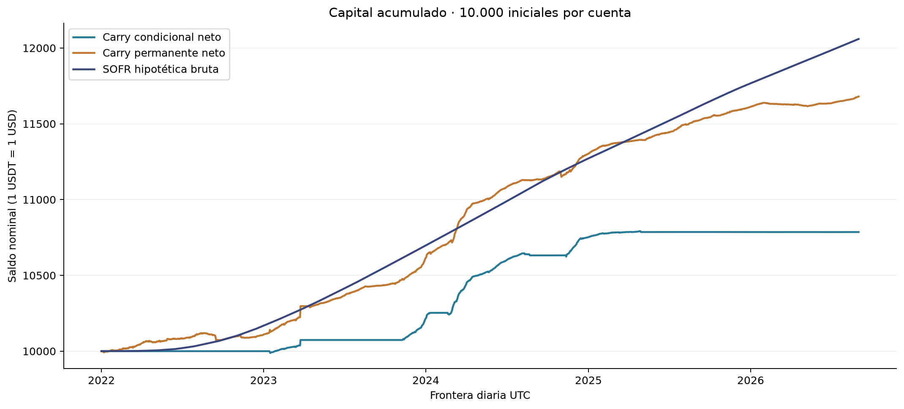

# Carry y cuenta SOFR hipotética

La cuenta ligada a SOFR permite dimensionar el costo de oportunidad del capital completo. Se comparan tres cuentas independientes con 10.000 iniciales entre el 01/01/2022 y el 31/08/2026 UTC. El carry es neto de los costos modelados y está expresado en USDT; SOFR es hipotética bruta en USD. La comparación supone paridad nominal 1 USDT = 1 USD.

| Cuenta | Saldo final | Retorno | CAGR365 |
|---|---:|---:|---:|
| Carry condicional neto | 10.785,76 USDT | 7,86% | 1,63% |
| Carry incondicional neto | 11.680,07 USDT | 16,80% | 3,38% |
| SOFR hipotética bruta | 12.059,50 USD | 20,60% | 4,09% |

## Resultados

- Ambas carteras quedan por debajo de SOFR en la muestra completa. Las diferencias de P&L son −1.273,74 para la condicional y −379,43 para la incondicional, en unidades nominales comparadas. No son beneficios recuperables automáticamente remunerando caja.
- La comparación cambia por año. La incondicional supera el retorno SOFR en 2024 y queda por debajo en los demás cortes anuales. La condicional queda por debajo en los cinco. Enero–agosto de 2026 es un período parcial; cada cuenta conserva sus saldos reales entre años.
- SOFR aporta una referencia, no reemplaza H2. El comparador de H2 sigue siendo el carry incondicional, con Sharpe diario y RF=0. No se calcula Sharpe para la cuenta SOFR ni se infiere riesgo nulo de su suavidad contable.

## Convenciones y límites

Los intereses usan ACT/360 y capitalización al siguiente día hábil; CAGR usa 365 días. El calendario verificado y el contraste con el SOFR Index oficial respaldan el cálculo. Las tasas realizadas se utilizan retrospectivamente, sin afirmar que fueran conocidas por anticipado.

La cuenta SOFR no acredita un producto accesible ni una tasa pagada por Binance. Excluye conversión, intermediación, custodia, spread e impuestos; la paridad USDT/USD no garantiza convertibilidad ni equivalencia de riesgos. Sus intereses no se suman al carry. La [sensibilidad ex post de caja](../complementaria/README.md) es otro ejercicio, con supuestos propios y sin nuevas operaciones.

## Evidencia y detalle

- [Informe completo](evidencia/reporte.md), [protocolo](https://github.com/pgs00/crypto-carry-thesis-pablo-salerno/blob/634c88fcf985da742cfa55d83bc4c0f99e082610/results/benchmark_sofr/evidencia/documentos/protocolo.md) y [mapa de fuentes](https://github.com/pgs00/crypto-carry-thesis-pablo-salerno/blob/634c88fcf985da742cfa55d83bc4c0f99e082610/results/benchmark_sofr/evidencia/documentos/mapa_fuentes.md).
- [Comparación por año y subperíodo](evidencia/tablas/comparacion_periodos.csv), [diferencias](evidencia/tablas/diferencias_periodos.csv), [cuenta diaria](evidencia/tablas/cartera_sofr_diaria.csv) y [contrastes con SOFR Index](https://github.com/pgs00/crypto-carry-thesis-pablo-salerno/blob/634c88fcf985da742cfa55d83bc4c0f99e082610/results/benchmark_sofr/evidencia/tablas/control_sofr_index.csv).
- [Verificación del paquete](https://github.com/pgs00/crypto-carry-thesis-pablo-salerno/blob/634c88fcf985da742cfa55d83bc4c0f99e082610/results/benchmark_sofr/evidencia/README.md) e [índice del estudio](../README.md).
