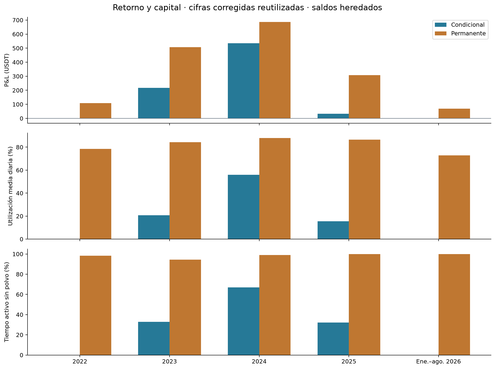

# Capital utilizado, concentración y entradas

La mejora predictiva de H1 no basta para permanecer invertido ni capturar más funding. Este análisis describe las dos carteras BASE entre el 01/01/2022 y el 31/08/2026 UTC, cada una iniciada con 10.000 USDT.

| Indicador de toda la muestra | Condicional | Incondicional |
|---|---:|---:|
| Utilización media diaria del patrimonio | 19,81% | 82,63% |
| Tiempo activo, sin polvo | 28,32% | 98,21% |
| Ciclos registrados | 10 | 20 |
| Tres mejores ciclos / ganancias de ciclos | 52,40% | 42,27% |

## Resultados

- La condicional despliega mucho menos capital. Su CAGR es 1,63%, frente al 3,38% de la incondicional. La menor utilización es consistente con menor captura de ingresos de funding, pero no demuestra cuánto rendiría eliminar filtros o remunerar caja: cambiar esas políticas podría alterar tamaños y decisiones.
- Las ganancias se concentran en pocos ciclos. Los tres mejores reúnen el 52,40% de las ganancias positivas de ciclos condicionales y el 42,27% de las incondicionales. El denominador es la suma de ganancias de los ciclos positivos, ya netas de los costos modelados; no es el capital inicial. No se calcula un CAGR contrafáctico eliminando los mejores ciclos.
- Una condición de mercado favorable no equivale a una entrada. De 10.224 evaluaciones por cartera, 480 pasan simultáneamente funding y basis; se acreditan 10 entradas condicionales y 20 incondicionales. Posiciones, caja y estado operativo determinan qué acciones son posibles. Los diagnósticos simultáneos se solapan y no deben sumarse como oportunidades perdidas. El funding de la incondicional es sólo diagnóstico.

Los 10 registros condicionales incluyen nueve ciclos cerrados y una apertura incompleta. Los 20 incondicionales incluyen 15 cerrados, tres aperturas incompletas y dos posiciones abiertas al final. Por eso no equivalen a 10 y 20 aperturas completas.

## Evolución anual y lectura económica

La condicional obtiene retornos de 5,24% en 2024, 0,31% en 2025 y aproximadamente cero en enero–agosto de 2026. La incondicional obtiene 6,47%, 2,73% y 0,59%, respectivamente. La mejora del promedio 2024–agosto de 2026 frente a 2022–2023 no implica una mejora sostenida año a año.

El capital utilizado es spot valuado más garantía al cierre, dividido por patrimonio; puede superar 100% por la valoración del corto. No equivale al tiempo activo, a la caja libre ni al máximo intradía. El retorno se mide sobre patrimonio, sin dividir CAGR por utilización. Los cortes heredan saldos y sus retornos no se suman.

H2 conserva el Sharpe diario con RF=0 y es no favorable en la muestra completa y ambos cortes originales. El Sharpe condicional de 2022 permanece ND. La [cuenta SOFR](../benchmark_sofr/README.md) compara capital completo; la [sensibilidad de caja del complemento](../complementaria/README.md) es un cálculo exploratorio separado, sin resimular operaciones.

## Evidencia y detalle

- [Informe completo](evidencia/reporte.md), [protocolo](https://github.com/pgs00/crypto-carry-thesis-pablo-salerno/blob/634c88fcf985da742cfa55d83bc4c0f99e082610/results/capital/evidencia/documentos/protocolo.md) y [fuentes](https://github.com/pgs00/crypto-carry-thesis-pablo-salerno/blob/634c88fcf985da742cfa55d83bc4c0f99e082610/results/capital/evidencia/documentos/mapa_fuentes.md).
- [Resultados anuales y capital en USDT](evidencia/tablas/resumen_integrado.csv), [concentración por ciclo](evidencia/tablas/concentracion_ciclos.csv), [entradas acreditadas](https://github.com/pgs00/crypto-carry-thesis-pablo-salerno/blob/634c88fcf985da742cfa55d83bc4c0f99e082610/results/capital/evidencia/tablas/entradas_acreditadas.csv) y [motivos simultáneos](evidencia/tablas/motivos_simultaneos.csv).
- [Verificación del paquete](https://github.com/pgs00/crypto-carry-thesis-pablo-salerno/blob/634c88fcf985da742cfa55d83bc4c0f99e082610/results/capital/evidencia/README.md) e [índice del estudio](../README.md).
