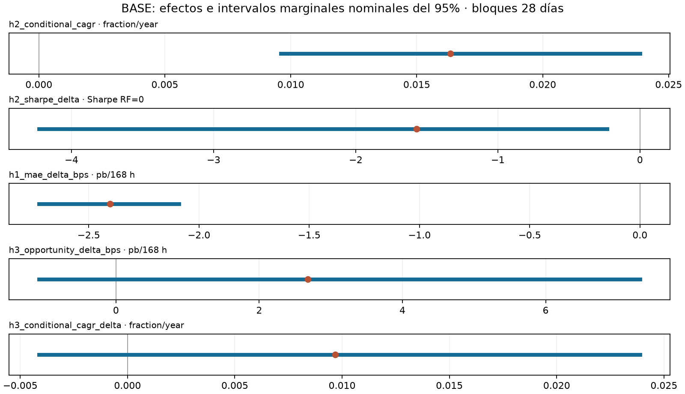

# Estabilidad temporal e incertidumbre

Cambiar la fecha inicial permite examinar cuánto dependen los resultados del recorrido previo. Se abren cuentas nuevas con 10.000 USDT desde enero de 2023 y enero de 2024, sin posiciones heredadas, y se comparan con sus tramos coincidentes de BASE. Todas terminan el 31/08/2026 UTC y operan BTCUSDT/ETHUSDT.

| Cuenta | CAGR condicional | CAGR incondicional | Sharpe condicional menos incondicional |
|---|---:|---:|---:|
| BASE desde 2022 | 1,63% | 3,38% | −1,57 |
| Cuenta nueva desde 2023 | 2,08% | 3,85% | −2,83 |
| Cuenta nueva desde 2024 | 2,24% | 3,66% | −3,86 |

## Resultados

- Los inicios alternativos no revierten H2 en sus muestras completas. Los CAGR condicionales son positivos, pero sus Sharpes diarios, con RF=0, siguen por debajo de los incondicionales. Los tramos coincidentes heredados de BASE también son no favorables.
- Reiniciar una cuenta no equivale a recortar una trayectoria. Desde 2024, la condicional nueva obtiene CAGR 2,24%, frente a 2,05% del tramo BASE que hereda patrimonio y posiciones. Cada comparación usa su saldo inicial real. Toda la historia ya había sido examinada: los inicios alternativos no son validación fuera de muestra.
- El remuestreo cuantifica incertidumbre bajo supuestos explícitos. Para BASE completa, el bootstrap principal de bloques de 28 días produce un intervalo marginal nominal del 95% de −4,23 a −0,23 para la diferencia de Sharpe, y de 0,96% a 2,39% para el CAGR condicional. Son intervalos separados, no una prueba conjunta de H2 al 95% ni probabilidades de ganancias futuras.

## Alcance

Se usan bloques circulares emparejados dentro de año y segmento, 5.000 réplicas y longitudes alternativas de 14 y 56 días. La estabilidad dentro de cada estrato, la dependencia entre años, los pocos ciclos y los días inactivos limitan la inferencia. Menos del 95% de réplicas válidas deja el intervalo principal ND; la evidencia conserva esos casos.

H3 original permanece en BASE: las cuentas nuevas no cubren todo su primer régimen. No se agregan sensibilidades como observaciones independientes. Las excepciones de H2 en [señal](../senal/README.md), [capital y costos](../costos_capacidad/README.md), [demoras](../ejecucion/README.md) y [escenario sin interrupción](../estres/README.md) conservan sus períodos propios. Los drawdowns de este análisis son diarios.

## Evidencia y detalle

- [Informe completo](evidencia/reporte.md) y [síntesis transversal](https://github.com/pgs00/crypto-carry-thesis-pablo-salerno/blob/634c88fcf985da742cfa55d83bc4c0f99e082610/results/estabilidad/evidencia/sintesis.md).
- [Métricas y denominadores](evidencia/tablas/metricas.csv), [saldos iniciales](evidencia/tablas/saldos_iniciales.csv), [H2 por período](evidencia/tablas/h2.csv), [intervalos y casos no evaluables](evidencia/tablas/bootstrap_intervalos.csv) y [protocolo estadístico](https://github.com/pgs00/crypto-carry-thesis-pablo-salerno/blob/634c88fcf985da742cfa55d83bc4c0f99e082610/results/estabilidad/evidencia/estadistica/protocolo.json).
- [Verificación del paquete](https://github.com/pgs00/crypto-carry-thesis-pablo-salerno/blob/634c88fcf985da742cfa55d83bc4c0f99e082610/results/estabilidad/evidencia/README.md) e [índice del estudio](../README.md).
