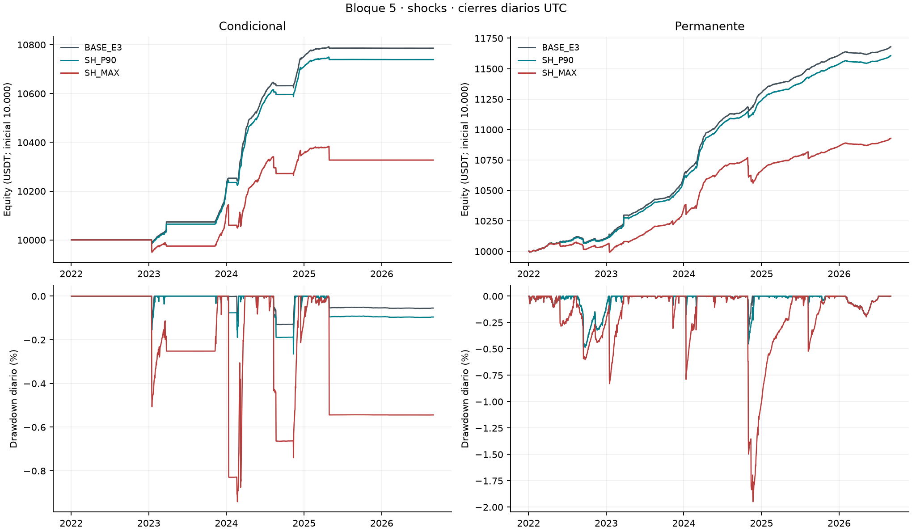

# Estrés spot y escenario sin interrupción

Tres intervenciones hipotéticas evalúan pérdidas por caídas spot y una trayectoria alternativa durante la suspensión de marzo de 2023. Cada escenario contiene una cartera condicional y otra incondicional, con 10.000 USDT iniciales, BTCUSDT/ETHUSDT y muestra continua del 01/01/2022 al 31/08/2026 UTC.

| Escenario | CAGR condicional | CAGR incondicional | DD diario condicional | DD diario incondicional |
|---|---:|---:|---:|---:|
| BASE | 1,63% | 3,38% | −0,21% | −0,48% |
| Caída spot P90 | 1,54% | 3,24% | −0,26% | −0,49% |
| Caída spot máxima | 0,69% | 1,92% | −0,94% | −1,95% |
| Sin interrupción | 1,52% | 3,11% | −0,26% | −0,62% |

## Resultados

- El shock máximo reduce sustancialmente el carry. Frente a BASE, el patrimonio final baja 458,51 USDT en la condicional y 752,32 en la incondicional. Ambas mantienen CAGR positivo, con mayor drawdown diario. Las magnitudes P90 y máxima proceden de episodios históricos; no representan probabilidades de pérdida ni niveles de confianza.
- El escenario sin interrupción termina con menor patrimonio que BASE. Las diferencias finales son −55,15 y −144,91 USDT. El ejercicio modifica precios y volumen spot durante la suspensión y conserva sus efectos posteriores en operaciones y saldos. No identifica el costo causal real de la interrupción ni permite atribuir toda la diferencia final a ese día.
- H2 sigue no favorable en los tres escenarios completos. El Sharpe diario, con RF=0, no supera al incondicional con el criterio conjunto de H2. El escenario sin interrupción sí resulta favorable en 2022–2023 y en 2023. H3 conserva la lectura `contraria` en los tres escenarios, después de recalcular la oportunidad del mercado modificado.

## Supuestos que condicionan la lectura

Los shocks reducen spot respecto del perpetuo; no estresan conjuntamente todos los mercados ni la resistencia del corto a subas del mark. La recuperación de 60 minutos es impuesta. El calendario de intervención se fija desde BASE y no añade automáticamente shocks a nuevas exposiciones de las trayectorias modificadas.

El escenario sin interrupción usa anclas y volumen hipotéticos predefinidos. Su valoración no recupera precios observables durante el cierre real. Las pérdidas y necesidades de garantía intradía se limitan a las ventanas auditadas; no son máximos globales de toda la muestra. Se mantienen las reglas prescritas y aproximaciones de BASE. La atribución del factor impuesto es diagnóstica y no se suma otra vez al P&L; el slippage ya está en los precios.

## Evidencia y detalle

- [Informe completo](evidencia/reporte.md), [ficha de supuestos](evidencia/ficha_decision.md) y [protocolo técnico](evidencia/protocolo_tecnico.md).
- [Métricas por período](evidencia/resultados/metricas.csv), [H2 con excepciones](evidencia/resultados/h2.csv), [H3](evidencia/resultados/h3_resumen.csv), [contraste diario sin interrupción](evidencia/resultados/cf_contraste_diario.csv) y [garantías en las ventanas](evidencia/resultados/garantias_resumen.csv).
- [Verificación del paquete](evidencia/README.md), [reproducción](evidencia/reproducibilidad.md) e [índice del estudio](../README.md).
