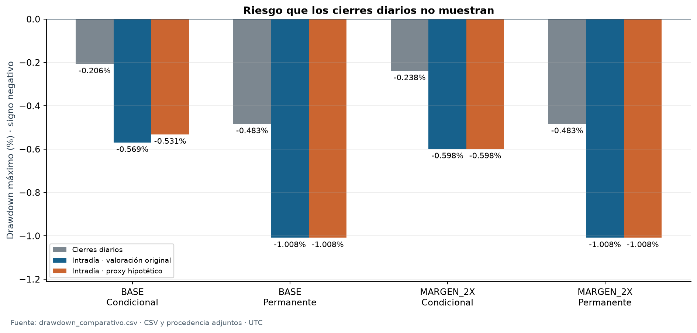

# Riesgo intradía, interrupciones y garantías

La valoración intradía muestra pérdidas transitorias mayores que los cierres diarios. El análisis reconstruye cuatro carteras existentes (BASE y mantenimiento duplicado, condicional e incondicional) entre el 01/01/2022 y el 31/08/2026 UTC. No vuelve a simular las estrategias.

| BASE | Drawdown diario | Drawdown intradía original | Intradía con proxy de suspensión |
|---|---:|---:|---:|
| Condicional | −0,2062% | −0,5689% | −0,5313% |
| Incondicional | −0,4827% | −1,0081% | −1,0081% |

## Resultados

- El cierre diario subestima las caídas transitorias de estas trayectorias. El drawdown intradía original aumenta en 0,36 y 0,53 puntos porcentuales, respectivamente. Se observa la unión de minutos y eventos financieros, no cada operación del mercado ni el recorrido dentro de una vela.
- La suspensión spot introduce riesgo y una limitación de valoración. El 24/03/2023 hubo 152 minutos sin un nuevo cierre spot y 121 minutos de exposición activa sin cobertura en ambas carteras BASE. Son duraciones distintas. En la condicional, el pico que precede al peor drawdown original utiliza un precio spot antiguo; por ello no equivale a un máximo de riqueza ejecutable observado. El proxy hipotético se muestra separado y no supone que se hubiera podido vender durante la suspensión.
- No se observó déficit de mantenimiento, pero sí necesidades preventivas. La menor holgura aislada BASE fue 486,21 USDT en la condicional y 501,93 en la incondicional. La máxima necesidad preventiva conjunta alcanzó ínfimos de 18,94 y 15,10 USDT. Una frontera estricta puede exigir un importe superior al ínfimo; éste no es automáticamente un aporte suficiente. La disponibilidad neta de caja no es acreditable en todos los estados.

## Alcance

Se mantienen separadas la pérdida de cartera, la necesidad de garantía y la exposición sin cobertura. No se suman máximos de distintos activos o instantes. Los resultados conservan incertidumbre durante la suspensión y las aproximaciones de mark/funding de BASE. Los cierres diarios concilian con las cuentas originales; esa conciliación no vuelve contemporáneo un precio antiguo.

H2 conserva el Sharpe diario con RF=0 y su resultado no favorable en BASE y mantenimiento duplicado para la muestra completa y ambos cortes originales. La reconstrucción intradía no redefine el contraste. Los [escenarios de ejecución](../ejecucion/README.md) y [estrés](../estres/README.md) estudian intervenciones distintas.

## Evidencia y detalle

- [Informe completo](evidencia/reporte.md) y [protocolo](evidencia/documentos/protocolo.md).
- [Drawdowns por cartera, período y convención](evidencia/tablas/drawdown_comparativo.csv), [garantías](evidencia/tablas/garantias_periodo.csv) y [catálogo de episodios](evidencia/tablas/catalogo_incidentes.csv).
- [Verificación y fuentes](evidencia/README.md). El paquete compacto comprueba la evidencia exportada; recalcular los máximos globales exige la serie completa y sus fuentes locales.
- [Índice del estudio](../README.md).
